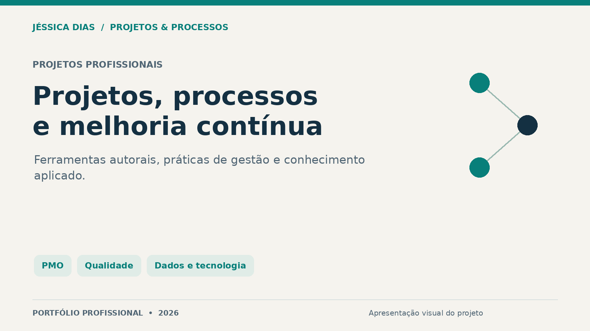

# Jéssica Caroline da Silva Dias

**Projetos e Processos · PMO · Qualidade · Melhoria Contínua**  
Brasília, Distrito Federal · [LinkedIn](https://www.linkedin.com/in/jessica-carolines-dias/)

## Sobre mim e este portfólio

Sou **Jéssica Caroline da Silva Dias**, analista de Projetos e Processos, com experiência em **PMO, melhoria contínua, qualidade e governança documental**. Tenho MBA em Gestão de Projetos e graduação em Análise e Desenvolvimento de Sistemas. Minha trajetória conecta gestão, tecnologia e atendimento, com atuação em cronogramas, riscos, indicadores, documentação e acompanhamento de implantações.

Utilizo **Monday.com, Bizagi, Excel, Google Sheets, Looker Studio e Power BI** em atividades de organização, modelagem de processos e análise de informações. Entre as entregas apresentadas estão mapas AS IS e TO BE em BPMN, controles de acompanhamento, propostas de melhoria e ferramentas de apoio à gestão.

Este portfólio reúne o **CicloTrama**, o **Orion PMO**, o **assistente de IA para qualidade** e a ferramenta de **classificação e numeração SGQ**, além de projetos de mapeamento de processos, comunicação profissional e maturidade de dados. Cada apresentação relaciona o problema, a abordagem, as ferramentas e as entregas demonstráveis, com descrições e imagens.

## Projetos

| Projeto | Proposta |
| --- | --- |
| [CicloTrama](projetos/ciclotrama/) | Ferramenta autoral para processos, projetos e operações. |
| [Orion PMO](projetos/orion-pmo/) | Protótipo de assistência a rotinas de projetos. |
| [IA para qualidade](projetos/assistente-ia-qualidade/) | Apoio à preparação e à padronização de documentos. |
| [Classificação e numeração SGQ](projetos/classificacao-numeracao-sgq/) | Ferramenta de apoio a referências documentais. |
| [Mapeamento e Otimização de Processos](projetos/mapeamento-processos/) | Análise AS IS, proposta TO BE e acompanhamento. |
| [O Poder de Conectar e Transformar](projetos/conectar-transformar/) | Capacitação em comunicação, empatia e experiência. |
| [Maturidade de Dados](projetos/maturidade-dados/) | Estudo sobre governança e transformação organizacional. |

## Explore o portfólio

- [Guia de consulta](docs/wiki/Home.md): projetos, metodologia, ferramentas e perguntas frequentes.
- [Plano de evolução](ROADMAP.md): próximos passos e tarefas de acompanhamento.
- [Sugestões e melhorias](https://github.com/jessicacarolinesdias/Portfolio-Profissional/issues): espaço para registrar observações sobre as apresentações.
- [Verificações da documentação](https://github.com/jessicacarolinesdias/Portfolio-Profissional/actions): conferência automática de referências locais e imagens PNG.

## Competências de trabalho

- **Projetos e PMO:** cronogramas, marcos, riscos, planos de ação, status e acompanhamento de implantação.
- **Processos e qualidade:** BPMN, AS IS e TO BE, SGQ, POPs, controle documental e melhoria contínua.
- **Dados e acompanhamento:** organização de informações, indicadores, planilhas e painéis.
- **Tecnologia e comunicação:** requisitos, documentação, suporte a sistemas e materiais de capacitação.

Ferramentas de apoio na trajetória profissional: Monday.com, Miro, Fluig, Trello, Azure DevOps, Bizagi, Figma, Excel, Google Sheets, Looker Studio, Power BI, TOPdesk, Salesforce, Comunix e Wiki interna. As ferramentas são apresentadas conforme as experiências e os projetos descritos.

## Como ler as evidências

As capturas reais do CicloTrama estão identificadas e usam dados demonstrativos ou exemplos. Nos demais projetos, as ilustrações são sínteses criadas para o portfólio e não são apresentadas como capturas de ferramentas em uso.

Os resultados são descritos como entregas verificáveis ou objetivos a medir. Indicadores de demonstração não representam ganhos de uma empresa. Projetos ligados a contextos organizacionais são apresentados de forma genérica, sem identificação das organizações ou divulgação de suas informações internas.

## Publicação dos materiais

Esta é uma vitrine de textos e imagens. Implementações, instaladores, prompts, dados e arquivos internos não integram esta publicação.

[Direitos sobre os materiais](COPYRIGHT.md).
