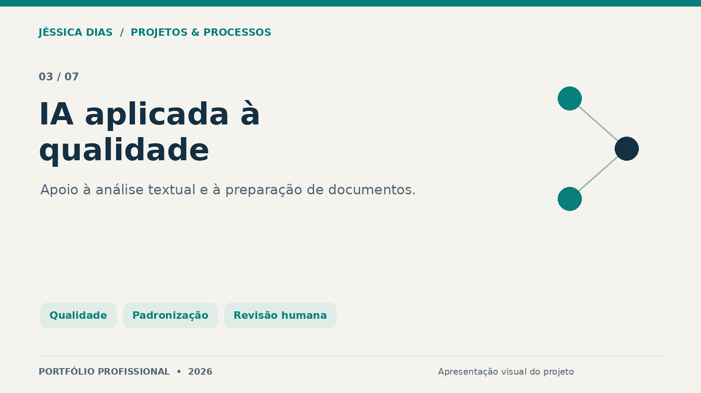
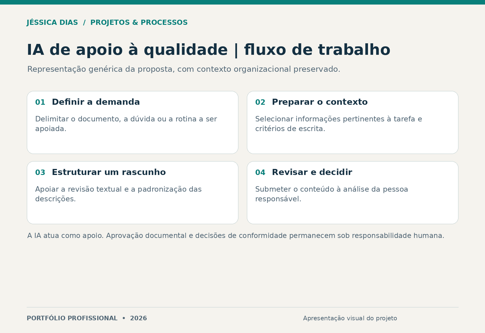

# Assistente de IA para qualidade e documentação

Projeto de assistente para apoiar a preparação de textos, a padronização de descrições e a organização de rotinas de qualidade. O contexto da organização de origem é preservado.

**Tipo:** ferramenta de apoio com IA.  
**Papel da autora:** concepção, organização das orientações de uso e estruturação das tarefas de apoio à qualidade.

## Problema e proposta

A redação de documentos de qualidade demanda consistência de linguagem e atenção aos critérios da atividade. A proposta utiliza IA para apoiar rascunhos e revisões textuais que serão avaliados por uma pessoa responsável.

## Fluxo de uso

O diagrama é uma representação genérica criada para o portfólio. Não reproduz instruções internas, documentos, taxonomias ou a interface de uma organização.

## Aplicações de apoio

- Estruturação de rascunhos e descrições de rotinas.
- Apoio à revisão textual e à padronização da linguagem documental.
- Organização de informações para análise e revisão humana.

## Entrega e limites

A entrega apresentada é a proposta de uso e organização do assistente. Não se afirma que a ferramenta realiza auditorias, aprova documentos ou garante conformidade com normas e legislação. Não são divulgadas métricas de desempenho ou implantação produtiva sem evidência de medição.

## Competências demonstradas

Qualidade, gestão documental, padronização, análise de processos, desenho de tarefas assistidas por IA e revisão crítica de conteúdo.

## Conteúdo desta vitrine

Somente apresentação e ilustração. Prompts, bases de conhecimento, regras internas e dados de trabalho permanecem reservados.

## Autoria e contato

**Jéssica Caroline da Silva Dias** — Projetos, Processos, PMO, Qualidade e Melhoria Contínua.

[LinkedIn](https://www.linkedin.com/in/jessica-carolines-dias/) · [Portfólio central](../../)

[Direitos sobre os materiais](COPYRIGHT.md).
