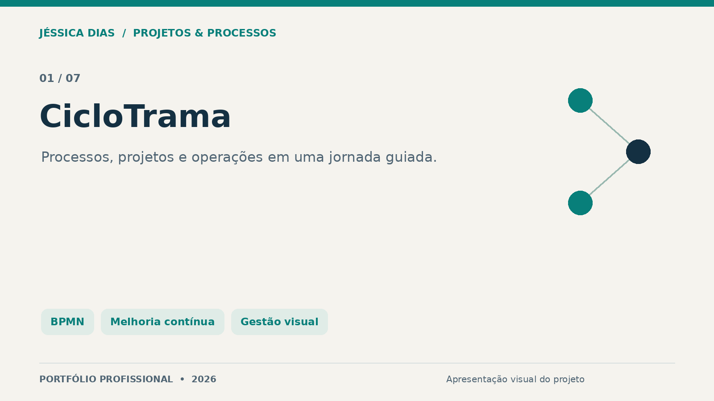
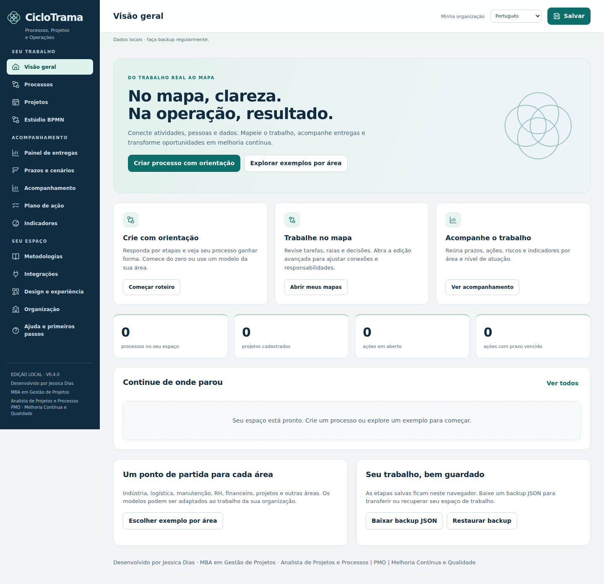
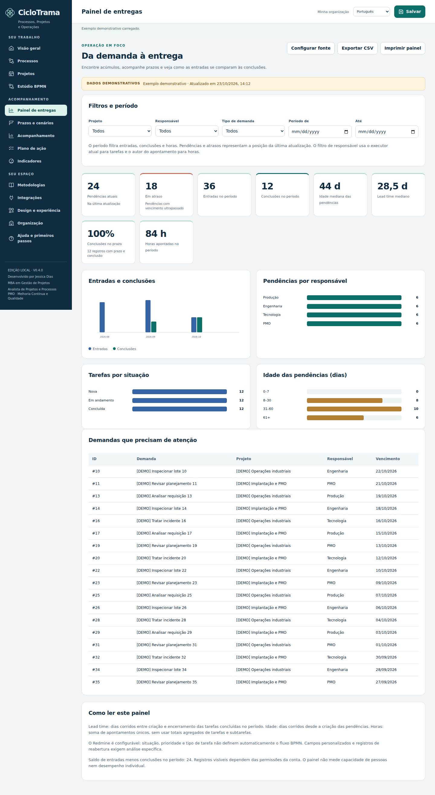
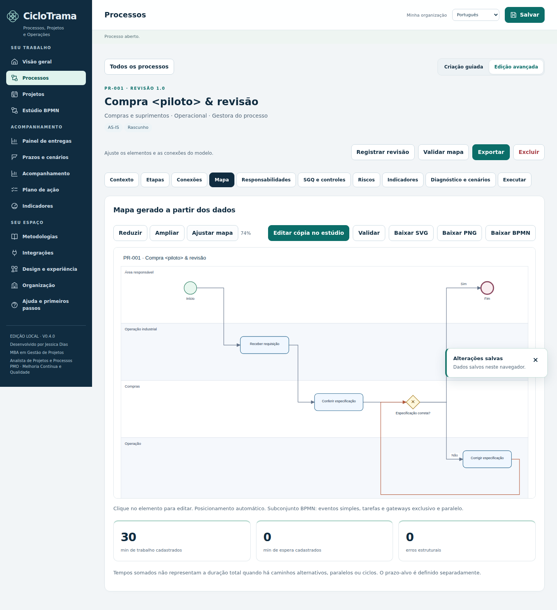

# CicloTrama

Ferramenta autoral para organizar processos, projetos e rotinas operacionais. A proposta reúne orientação de preenchimento, mapas de processo, responsabilidades, riscos, indicadores e planos de ação em um mesmo espaço de trabalho.

**Tipo:** ferramenta autoral e protótipo funcional em evolução.  
**Referência apresentada:** versão 0.4.0, de outubro de 2026.  
**Papel da autora:** concepção, requisitos, regras de negócio, documentação e evolução da solução, com apoio de IA e revisão das entregas.

## Problema e proposta

Informações sobre um processo podem ficar dispersas entre documentos, planilhas e quadros. O CicloTrama busca estruturar esse levantamento e conectá-lo ao acompanhamento de atividades e melhorias.

## Recursos presentes na versão apresentada

- Jornada guiada: contexto, etapas, responsáveis, revisão do mapa, melhorias e exportação.
- Registro de processos, projetos, responsáveis, riscos, indicadores e planos de ação.
- Modelagem com elementos BPMN e verificações de um subconjunto de regras estruturais.
- Painel de entregas e importação de informações do Redmine; a conectividade com um ambiente real ainda requer validação.
- Cenários de prazo com estimativas e dependências, sujeitos às hipóteses do modelo.
- Exportações de mapas em BPMN, SVG e PNG, além de documentos de apoio.
- Salvamento local e recursos de cópia de segurança conforme o modo de execução.

## Galeria real da ferramenta

As imagens abaixo são capturas da versão em validação. Os dados são demonstrativos ou exemplos de processo; seus números não representam resultados profissionais ou indicadores de uma empresa.

### Início e organização do trabalho

### Painel com dados demonstrativos

### Exemplo de mapa de processo

## Entregas e limites de validação

A entrega demonstrável é um protótipo funcional documentado, com interfaces para cadastro, organização e visualização do trabalho. Não são alegados percentuais de produtividade, adoção por empresas ou retorno financeiro.

Validações com usuários, interoperabilidade completa com ferramentas externas e conexões com ambientes reais continuam como etapas de evolução. As verificações do editor não equivalem a certificação integral de conformidade BPMN. Estimativas de prazo não são garantias de entrega.

## Competências demonstradas

Levantamento de requisitos, análise de processos, BPMN, documentação, regras de negócio, gestão visual, melhoria contínua e uso crítico de IA no desenvolvimento de ferramentas de apoio.

## Conteúdo desta vitrine

Somente apresentação e imagens selecionadas. Código-fonte, executáveis, arquivos de instalação e dados de trabalho permanecem fora deste repositório.

## Autoria e contato

**Jéssica Caroline da Silva Dias** — Projetos, Processos, PMO, Qualidade e Melhoria Contínua.

[LinkedIn](https://www.linkedin.com/in/jessica-carolines-dias/) · [Portfólio central](../../)

[Direitos sobre os materiais](COPYRIGHT.md).
