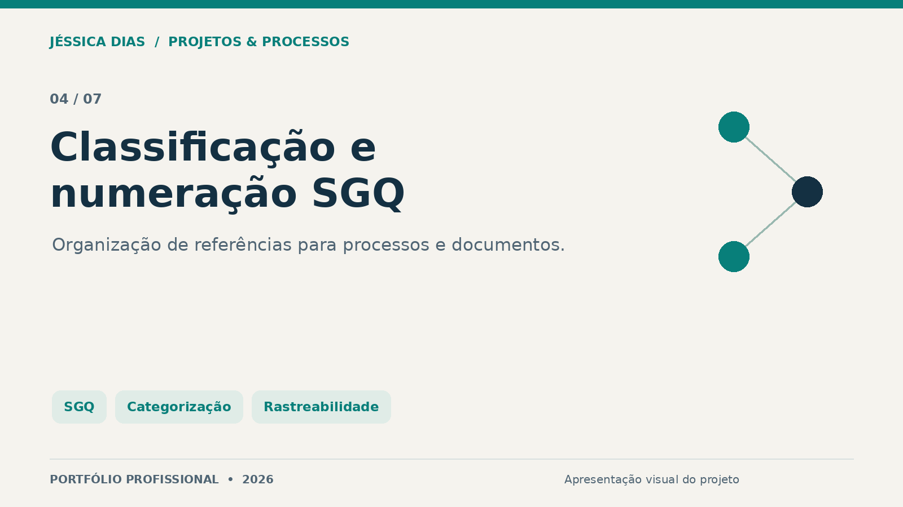
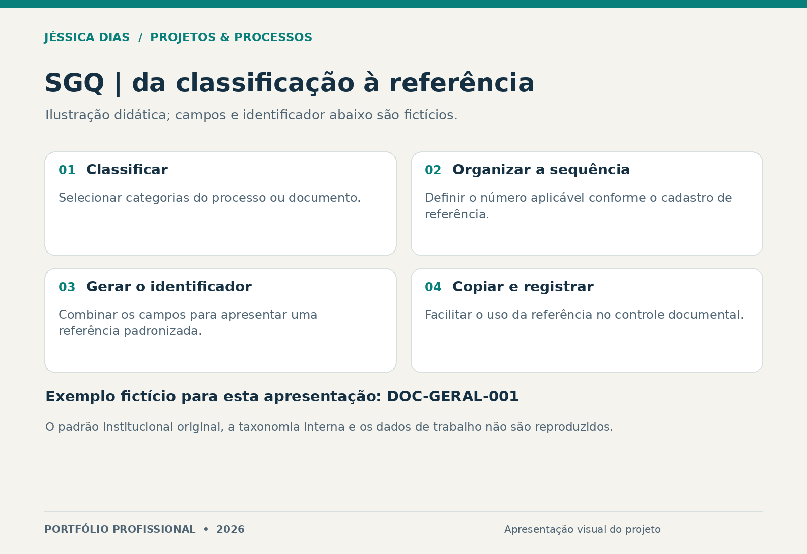

# Classificação e numeração de processos e documentos SGQ

Ferramenta de apoio à categorização e à geração de referências para o Sistema de Gestão da Qualidade (SGQ), com seleção de categorias, sequência numérica e cópia do identificador.

**Tipo:** ferramenta de apoio ao controle documental.  
**Papel da autora:** estruturação da necessidade, do fluxo de classificação e da geração de códigos.

## Problema e solução

A criação manual de referências pode produzir formatos inconsistentes. A ferramenta organiza a seleção de campos e a montagem de um identificador para uso nas rotinas de documentação.

## Recursos apresentados

- Seleção de categorias vinculadas ao processo ou documento.
- Preenchimento de um número sequencial.
- Composição e apresentação do código correspondente.
- Recurso para copiar o identificador gerado.

**DOC-GERAL-001 é um exemplo fictício desta apresentação.** Não corresponde à regra institucional original. Taxonomias, estruturas de códigos, cadastros, marcas e documentos internos não são reproduzidos.

## Entrega e limites

Protótipo funcional de formulário para classificação e composição de códigos. A geração de uma referência não substitui aprovação documental, controle de versões ou gestão de uma lista mestra. Não se alega certificação ISO ou conformidade automática.

## Competências demonstradas

SGQ, gestão documental, categorização de processos, requisitos, padronização de identificadores e rastreabilidade da informação.

## Conteúdo desta vitrine

Apresentação e diagrama genérico. A implementação e os padrões de uma organização permanecem reservados.

## Autoria e contato

**Jéssica Caroline da Silva Dias** — Projetos, Processos, PMO, Qualidade e Melhoria Contínua.

[LinkedIn](https://www.linkedin.com/in/jessica-carolines-dias/) · [Portfólio central](../../)

[Direitos sobre os materiais](COPYRIGHT.md).
