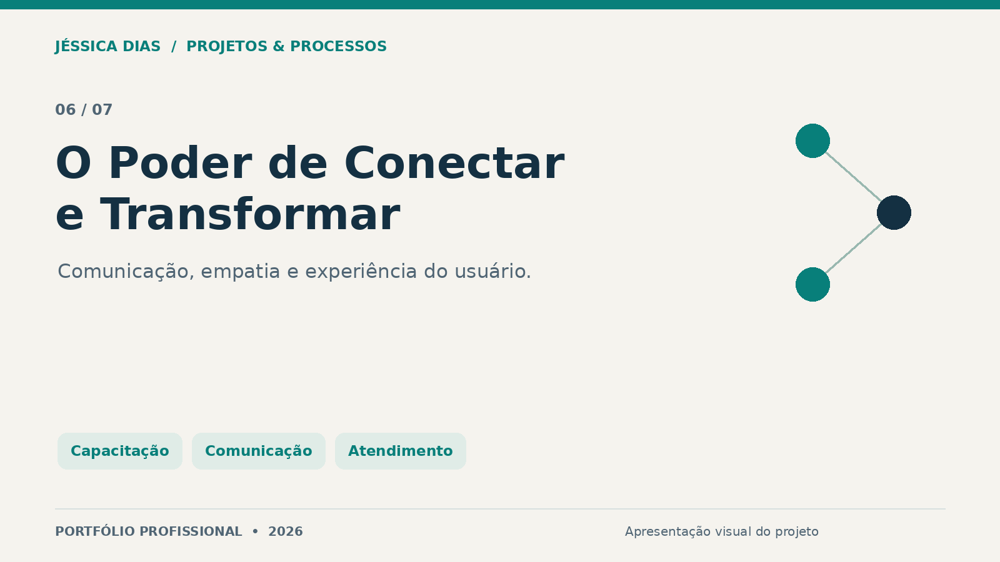
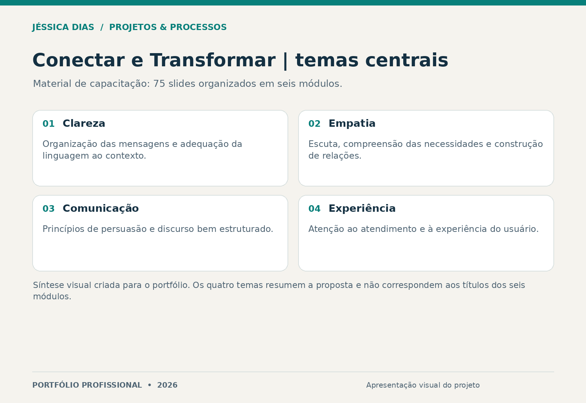

# O Poder de Conectar e Transformar

Material autoral de capacitação sobre comunicação, empatia, clareza da linguagem e experiência do usuário. Aplica esses temas ao atendimento e às interações profissionais.

**Tipo:** treinamento e material de desenvolvimento profissional.  
**Formato informado:** 75 slides organizados em seis módulos.  
**Papel da autora:** autoria e estruturação do conteúdo.

## Objetivo

Apoiar uma comunicação mais clara e adequada ao contexto, considerando as necessidades das pessoas e a qualidade da experiência de atendimento.

## Temas centrais

- Clareza e organização das mensagens.
- Empatia e compreensão das necessidades.
- Princípios de persuasão e construção do discurso.
- Relação entre linguagem, atendimento e experiência do usuário (UX).

Esta imagem é uma síntese criada para a apresentação do projeto. Os quatro temas acima não são a lista dos seis módulos, e a imagem não reproduz um slide original.

## Entrega e limites

A entrega é o material de capacitação. Não são alegados números de participantes, implantação em uma empresa ou aumento de satisfação sem registros de aplicação e avaliação.

## Competências demonstradas

Comunicação, linguagem, atendimento, experiência do usuário, organização de conteúdo e desenvolvimento de materiais de capacitação.

## Conteúdo desta vitrine

Apresentação e síntese visual. O material integral permanece reservado.

## Autoria e contato

**Jéssica Caroline da Silva Dias** — Projetos, Processos, PMO, Qualidade e Melhoria Contínua.

[LinkedIn](https://www.linkedin.com/in/jessica-carolines-dias/) · [Portfólio central](../../)

[Direitos sobre os materiais](COPYRIGHT.md).
