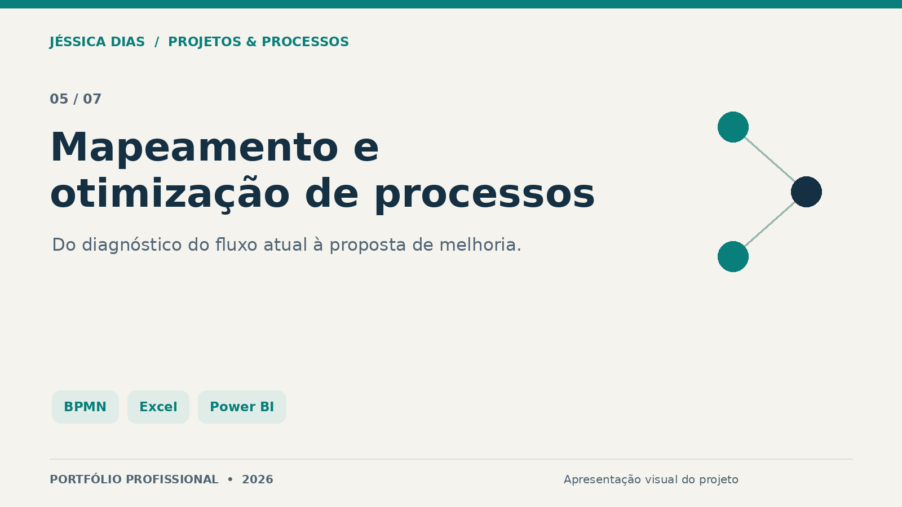
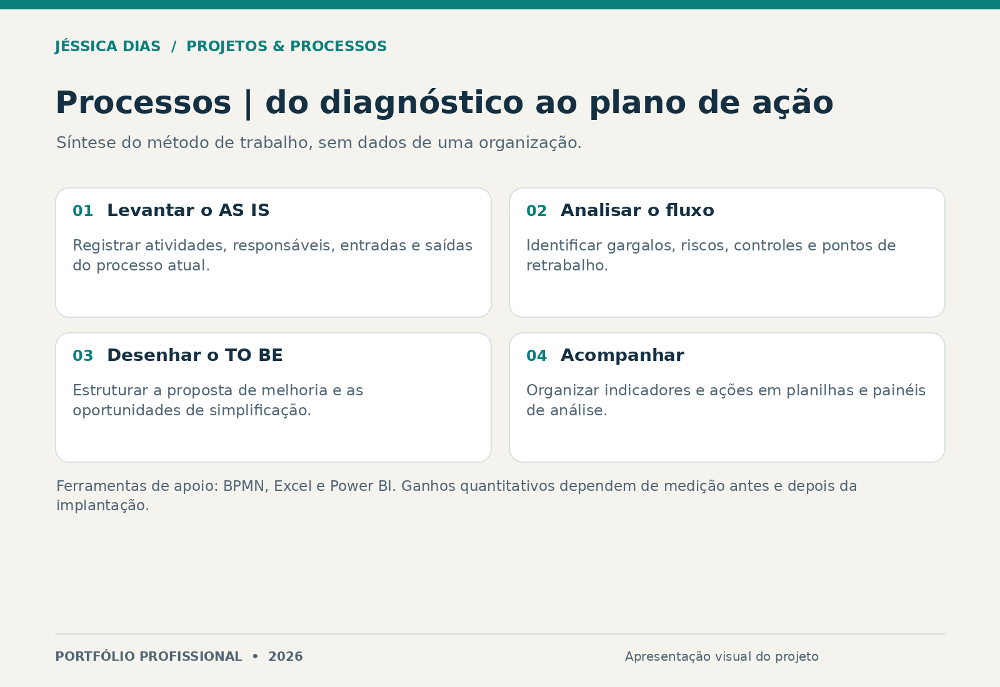

# Mapeamento e Otimização de Processos

Projeto voltado à análise de fluxos operacionais, identificação de gargalos e estruturação de propostas de melhoria. Conecta documentação do processo, análise de dados e acompanhamento de ações.

**Tipo:** estudo e prática de análise e melhoria de processos.  
**Papel da autora:** levantamento, análise de fluxos e organização de propostas e informações de acompanhamento.

## Método de trabalho

1. Levantar o processo atual, suas atividades, entradas, saídas e responsáveis.
2. Analisar pontos críticos, retrabalho, riscos e controles.
3. Estruturar o fluxo proposto e oportunidades de simplificação ou automação.
4. Organizar indicadores e planos de ação para acompanhamento.

## Ferramentas e entregas

| Ação | Ferramenta ou método | Entrega apresentada |
| --- | --- | --- |
| Levantar e redesenhar fluxos | BPMN, AS IS e TO BE | Mapas e documentação de processos |
| Organizar e analisar informações | Excel | Estrutura de controles e análise |
| Preparar visualização de indicadores | Power BI | Apoio à leitura e ao acompanhamento |
| Estruturar melhorias | Planos de ação | Propostas para tratamento dos pontos críticos |

O diagrama é uma síntese metodológica criada para o portfólio. Não é uma captura de painel, mapa ou documento de uma empresa.

## Resultados e medição

As entregas descritas são mapas, análises e propostas de melhoria. Redução de retrabalho, produtividade e economia são objetivos a medir após a implantação; não são apresentados percentuais ou ganhos financeiros sem uma base comparável.

## Competências demonstradas

Análise de processos, BPMN, melhoria contínua, organização de indicadores, Excel, Power BI e comunicação de propostas de melhoria.

## Autoria e contato

**Jéssica Caroline da Silva Dias** — Projetos, Processos, PMO, Qualidade e Melhoria Contínua.

[LinkedIn](https://www.linkedin.com/in/jessica-carolines-dias/) · [Portfólio central](../../)

[Direitos sobre os materiais](COPYRIGHT.md).
