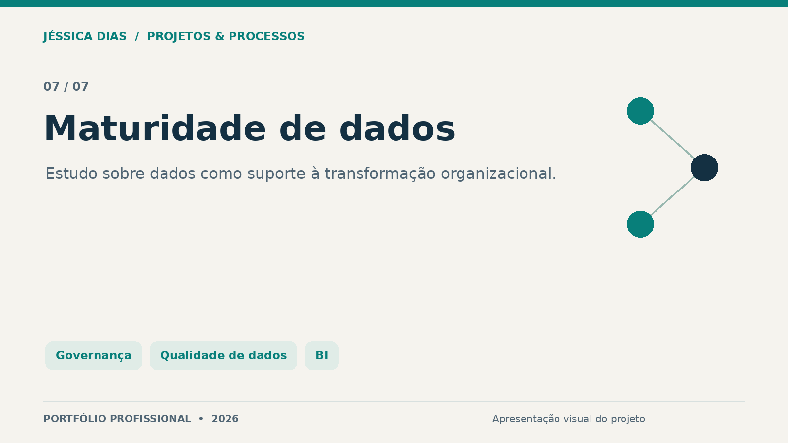
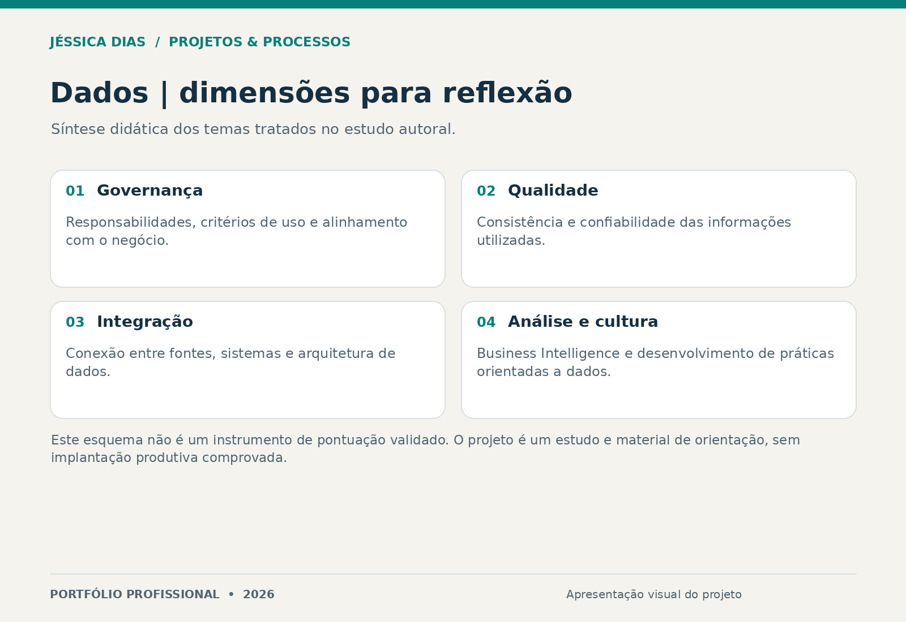

# Técnicas de Maturidade de Dados para Transformação Organizacional

Estudo e material autoral sobre governança, qualidade, integração e uso de dados no apoio à tomada de decisão. Relaciona maturidade de dados, Business Intelligence e cultura organizacional.

**Tipo:** estudo acadêmico e material de orientação.  
**Papel da autora:** pesquisa bibliográfica, síntese e redação do conteúdo.

## Questão abordada

Como organizar práticas e responsabilidades para transformar dados em informações úteis ao negócio e desenvolver uma cultura de decisão orientada por evidências?

## Dimensões discutidas

- Governança de dados e responsabilidades.
- Qualidade e confiabilidade das informações.
- Arquitetura e integração entre fontes e sistemas.
- Business Intelligence, análise e cultura de dados.

O esquema é uma síntese didática criada para o portfólio. Não representa uma escala de maturidade validada, uma medição de uma organização ou uma implementação de modelo preditivo.

## Entrega e limites

Pesquisa e material de orientação sobre práticas de maturidade de dados. Resultados de implantação, modelos em produção e ganhos financeiros não são alegados nesta apresentação.

## Competências demonstradas

Pesquisa, governança de dados, qualidade de dados, análise de processos, Business Intelligence e comunicação de conhecimento técnico.

## Conteúdo desta vitrine

Apresentação e síntese visual. O texto integral e os arquivos de trabalho permanecem reservados.

## Autoria e contato

**Jéssica Caroline da Silva Dias** — Projetos, Processos, PMO, Qualidade e Melhoria Contínua.

[LinkedIn](https://www.linkedin.com/in/jessica-carolines-dias/) · [Portfólio central](../../)

[Direitos sobre os materiais](COPYRIGHT.md).
