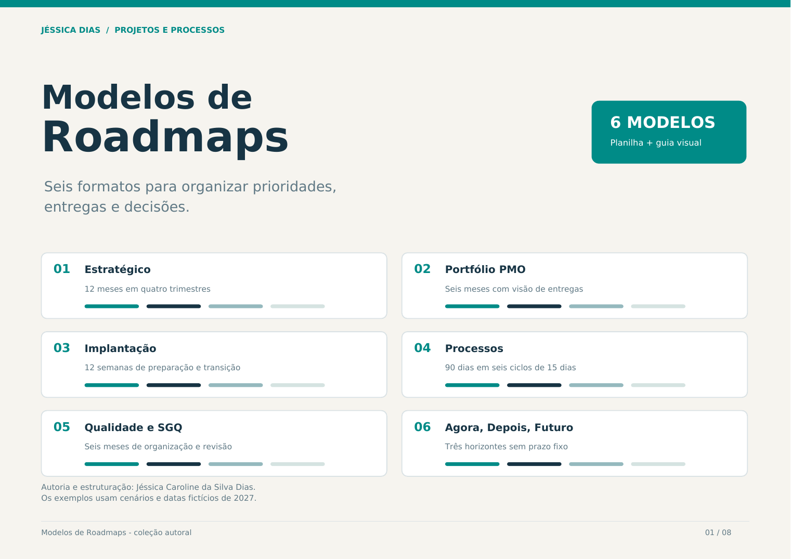
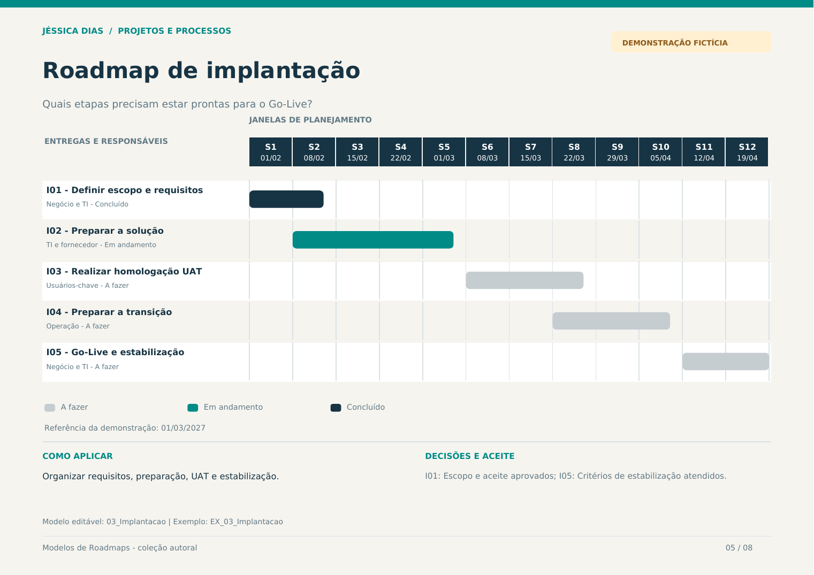
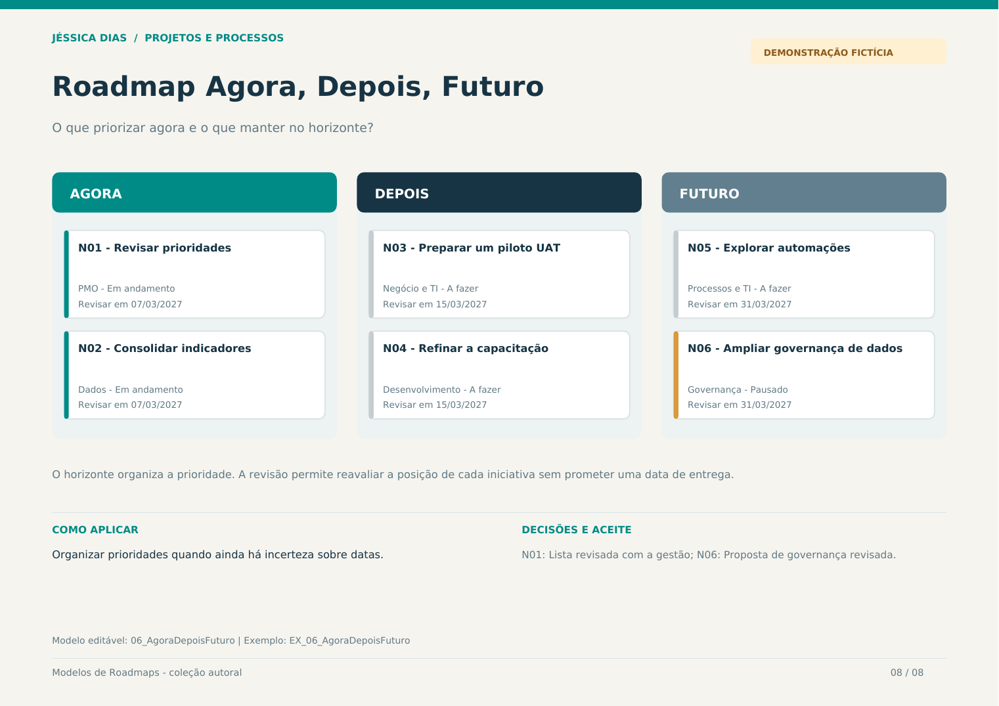

# Modelos de Roadmaps

**Planejamento visual · PMO · Processos · Qualidade**  
Autoria e estruturação: **Jéssica Caroline da Silva Dias**

Coleção de seis formatos para organizar prioridades, iniciativas, responsáveis, janelas de entrega e critérios de aceite. O projeto conecta minha atuação em projetos, processos e qualidade a materiais de planejamento editáveis, com exemplos fictícios de 2027.

## Acessar os materiais

- **[Planilha editável em Excel (.xlsx)](arquivos/Modelos_de_Roadmaps_Jessica_Dias.xlsx):** 13 abas, com uma orientação inicial, seis modelos em branco e seis exemplos preenchidos.
- **[Guia visual em PDF](arquivos/Guia_Visual_Modelos_de_Roadmaps.pdf):** oito páginas com orientação de escolha e uma demonstração de cada formato.
- **Modelos em Markdown:** estrutura para copiar, exemplo preenchido e orientações de revisão em cada página abaixo.

No GitHub, abra o arquivo e use **Download raw file** para baixar a planilha ou o PDF.

## Escolher o formato

| Modelo | Horizonte | Decisão que ajuda a organizar |
| --- | --- | --- |
| [Estratégico](modelos/01-estrategico.md) | 12 meses em quatro trimestres | Quais iniciativas sustentam as prioridades do ano? |
| [Portfólio PMO](modelos/02-pmo.md) | Seis meses | Como acompanhar a evolução da governança e das entregas? |
| [Implantação de sistemas](modelos/03-implantacao.md) | 12 semanas | Quais etapas precisam estar prontas para o Go-Live? |
| [Melhoria de processos](modelos/04-processos.md) | 90 dias em seis períodos de 15 dias | Como conectar diagnóstico, proposta, piloto e medição? |
| [Qualidade e SGQ](modelos/05-sgq.md) | Seis meses | Como organizar documentos, controles e ações de melhoria? |
| [Agora, Depois, Futuro](modelos/06-agora-depois-futuro.md) | Três horizontes sem prazo fixo | O que priorizar agora e o que manter no horizonte? |

## Problema, contribuição e entrega

Um planejamento pode ter tarefas registradas e ainda deixar pouco claras as prioridades, as dependências e as decisões de aceite. A proposta desta coleção é oferecer formatos para diferentes graus de definição do trabalho.

| Ação | Método ou recurso | Entrega verificável |
| --- | --- | --- |
| Estruturei seis modelos de planejamento alinhados a projetos, processos e qualidade. | Visão estratégica, governança de PMO, requisitos, UAT, AS IS e TO BE, SGQ e priorização por horizonte. | Seis modelos em branco e seis cenários fictícios preenchidos. |
| Organizei campos, regras de preenchimento e acompanhamento visual. | Planilha com fórmulas de datas, listas de seleção, barras de planejamento e alertas. | Arquivo editável com 13 abas e instruções. |
| Preparei exemplos e orientações de uso para consulta. | Diagramas, critérios de aceite e documentação em Markdown. | Guia visual de oito páginas e seis páginas individuais de modelos. |

A elaboração dos materiais contou com apoio de IA. Os exemplos demonstram a estrutura dos modelos; não representam projetos executados em empresas nem resultados de aplicação medidos.

## Como preencher a planilha

1. Na aba **Inicio**, escolha o formato e consulte a aba de exemplo correspondente, identificada pelo prefixo **EX_**.
2. Duplique a aba de modelo em branco. Cada modelo tem espaço para **12 iniciativas**.
3. Preencha as células amarelas com iniciativas, responsáveis, datas, prioridade, dependências, resultado esperado e marco de aceite.
4. Nos modelos com calendário, ajuste a **data-base** e a **data de revisão** em DD/MM/AAAA. A data-base determina o início da escala; a data de revisão orienta os alertas de pendência.
5. Use as listas de **status** e **prioridade**. No modelo Agora, Depois, Futuro, selecione também o horizonte e informe a data de próxima revisão de cada iniciativa.
6. Revise o planejamento a cada ciclo e registre as decisões. As células cinzas de apoio e a linha do tempo contêm fórmulas.

Os status disponíveis são **A fazer, Em andamento, Em validação, Concluído, Bloqueado e Pausado**. As prioridades são **Alta, Média e Baixa**. As barras usam cores conforme o status; as descrições permanecem visíveis para que a leitura não dependa apenas de cor.

As fórmulas desenham as janelas informadas e sinalizam datas incompletas, intervalos invertidos e entregas pendentes em relação à data de revisão. As dependências são referências informativas e **não reagendam outras entregas automaticamente**. A escala mostra o horizonte de cada modelo; entregas fora dele exigem ajustar a data-base ou criar um novo ciclo de planejamento.

O roadmap apresenta direção, sequência e decisões. O detalhamento diário das atividades e a medição dos resultados devem ser mantidos nos controles de execução apropriados.

## Demonstrações

### Implantação de sistemas

[Abrir o modelo de implantação](modelos/03-implantacao.md)

### Agora, Depois, Futuro

[Abrir o modelo por horizontes](modelos/06-agora-depois-futuro.md)

## Conferência dos materiais

- As 13 abas foram renderizadas e revisadas visualmente.
- Foram testadas mudanças de datas e de horizonte, ausência de datas e inversão de intervalos, com recálculo das fórmulas.
- A conferência do arquivo exportado identificou 26 validações de entrada, 12 abas com painéis congelados e nenhuma célula com erro de fórmula armazenado.
- As oito páginas do PDF foram renderizadas e revisadas, e os links locais foram conferidos pelo verificador do portfólio.

Os testes verificam o comportamento dos materiais de demonstração. Resultados de uso em projetos reais dependem de aplicação, acompanhamento e evidências próprias.

[Voltar ao portfólio](../../README.md) · [Guia do portfólio](../../docs/wiki/Home.md) · [Direitos sobre os materiais](../../COPYRIGHT.md) · [LinkedIn](https://www.linkedin.com/in/jessica-carolines-dias/)
