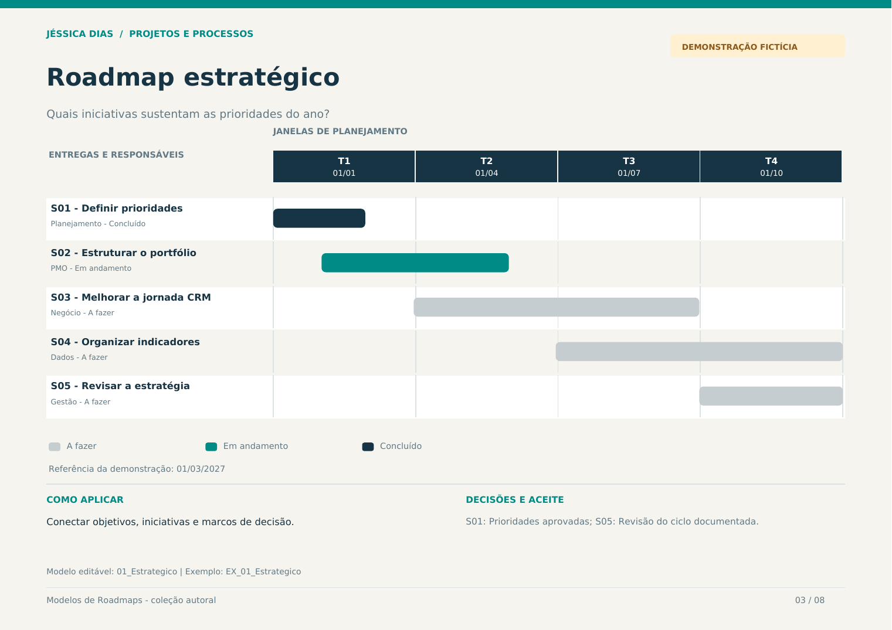

# Roadmap estratégico

**Quando usar:** Conectar objetivos, iniciativas e marcos de decisão.  
**Horizonte:** 12 meses em quatro trimestres  
**Pergunta orientadora:** Quais iniciativas sustentam as prioridades do ano?



## Modelo editável

Abra a aba **01_Estrategico** na [planilha da coleção](../arquivos/Modelos_de_Roadmaps_Jessica_Dias.xlsx). A aba **EX_01_Estrategico** contém o exemplo preenchido. Os campos amarelos são editáveis; status e prioridade possuem listas de seleção.

Defina a data-base e a data de revisão. O desenho acompanha as datas informadas em cada entrega.

## Estrutura para copiar

```markdown
| Entrega ou iniciativa | Responsável | Início | Fim | Status | Marco de aceite |
| --- | --- | --- | --- | --- | --- |
| [Preencher] | [Responsável] | [Data ou horizonte] | [Data] | [Status] | [Critério de aceite] |
```

## Exemplo preenchido

Todos os nomes de iniciativas, equipes, datas e status abaixo são fictícios.

| Entrega ou iniciativa | Responsável | Início | Fim | Status | Marco de aceite |
| --- | --- | --- | --- | --- | --- |
| S01 - Definir prioridades | Planejamento | 01/01/2027 | 28/02/2027 | Concluído | Prioridades aprovadas |
| S02 - Estruturar o portfólio | PMO | 01/02/2027 | 31/05/2027 | Em andamento | Responsáveis e marcos definidos |
| S03 - Melhorar a jornada CRM | Negócio | 01/04/2027 | 30/09/2027 | A fazer | Proposta de jornada validada |
| S04 - Organizar indicadores | Dados | 01/07/2027 | 31/12/2027 | A fazer | Definições e fontes registradas |
| S05 - Revisar a estratégia | Gestão | 01/10/2027 | 31/12/2027 | A fazer | Revisão do ciclo documentada |

## Revisão do planejamento

- Reavalie prioridades, responsáveis e critérios de aceite a cada ciclo.
- Registre mudanças de janela e decisões relevantes.
- Use dependências como referências: elas não reagendam outras entregas automaticamente.
- Atualize o resultado observado quando houver evidência de aplicação.

[Voltar à coleção](../README.md) · [Guia visual em PDF](../arquivos/Guia_Visual_Modelos_de_Roadmaps.pdf)
