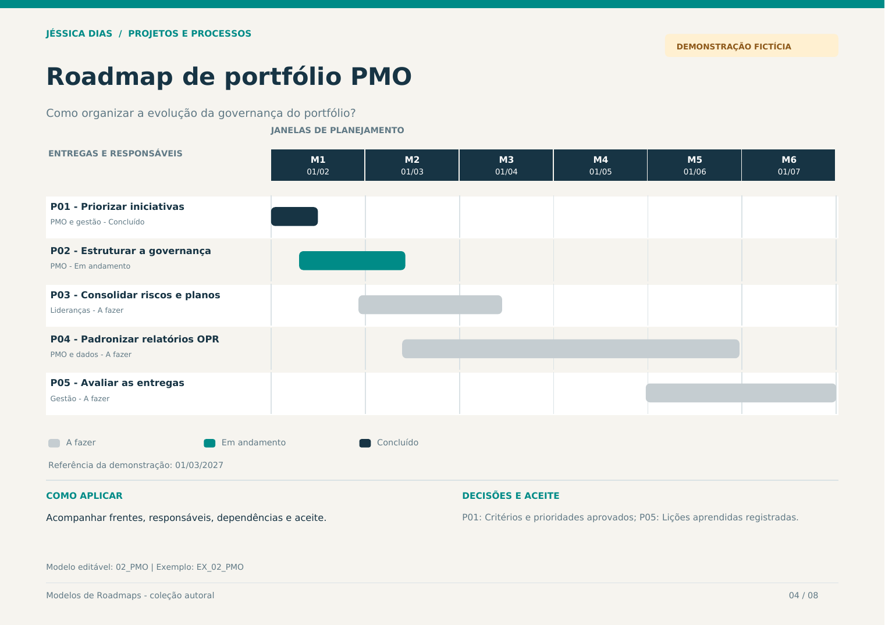

# Roadmap de portfólio PMO

**Quando usar:** Acompanhar frentes, responsáveis, dependências e aceite.  
**Horizonte:** Seis meses com visão de entregas  
**Pergunta orientadora:** Como organizar a evolução da governança do portfólio?



## Modelo editável

Abra a aba **02_PMO** na [planilha da coleção](../arquivos/Modelos_de_Roadmaps_Jessica_Dias.xlsx). A aba **EX_02_PMO** contém o exemplo preenchido. Os campos amarelos são editáveis; status e prioridade possuem listas de seleção.

Defina a data-base e a data de revisão. O desenho acompanha as datas informadas em cada entrega.

## Estrutura para copiar

```markdown
| Entrega ou iniciativa | Responsável | Início | Fim | Status | Marco de aceite |
| --- | --- | --- | --- | --- | --- |
| [Preencher] | [Responsável] | [Data ou horizonte] | [Data] | [Status] | [Critério de aceite] |
```

## Exemplo preenchido

Todos os nomes de iniciativas, equipes, datas e status abaixo são fictícios.

| Entrega ou iniciativa | Responsável | Início | Fim | Status | Marco de aceite |
| --- | --- | --- | --- | --- | --- |
| P01 - Priorizar iniciativas | PMO e gestão | 01/02/2027 | 15/02/2027 | Concluído | Critérios e prioridades aprovados |
| P02 - Estruturar a governança | PMO | 10/02/2027 | 15/03/2027 | Em andamento | Papéis e ritos definidos |
| P03 - Consolidar riscos e planos | Lideranças | 01/03/2027 | 15/04/2027 | A fazer | Riscos com ações e responsáveis |
| P04 - Padronizar relatórios OPR | PMO e dados | 15/03/2027 | 30/06/2027 | A fazer | Modelo de relatório revisado |
| P05 - Avaliar as entregas | Gestão | 01/06/2027 | 31/07/2027 | A fazer | Lições aprendidas registradas |

## Revisão do planejamento

- Reavalie prioridades, responsáveis e critérios de aceite a cada ciclo.
- Registre mudanças de janela e decisões relevantes.
- Use dependências como referências: elas não reagendam outras entregas automaticamente.
- Atualize o resultado observado quando houver evidência de aplicação.

[Voltar à coleção](../README.md) · [Guia visual em PDF](../arquivos/Guia_Visual_Modelos_de_Roadmaps.pdf)
