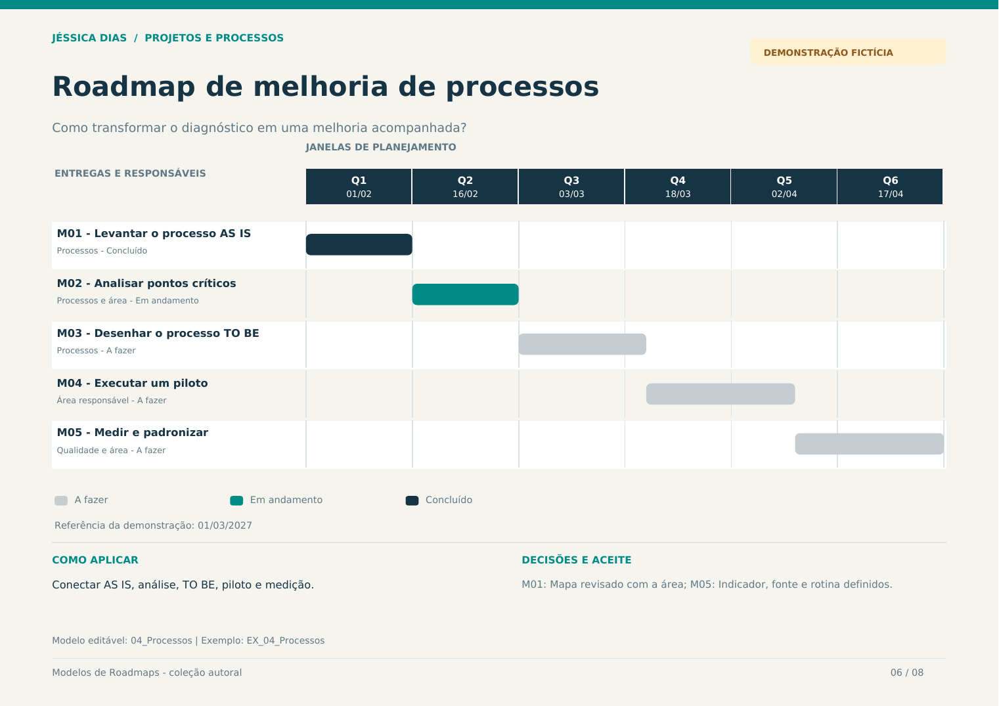

# Roadmap de melhoria de processos

**Quando usar:** Conectar AS IS, análise, TO BE, piloto e medição.  
**Horizonte:** 90 dias em seis ciclos de 15 dias  
**Pergunta orientadora:** Como transformar o diagnóstico em uma melhoria acompanhada?



## Modelo editável

Abra a aba **04_Processos** na [planilha da coleção](../arquivos/Modelos_de_Roadmaps_Jessica_Dias.xlsx). A aba **EX_04_Processos** contém o exemplo preenchido. Os campos amarelos são editáveis; status e prioridade possuem listas de seleção.

Defina a data-base e a data de revisão. O desenho acompanha as datas informadas em cada entrega.

## Estrutura para copiar

```markdown
| Entrega ou iniciativa | Responsável | Início | Fim | Status | Marco de aceite |
| --- | --- | --- | --- | --- | --- |
| [Preencher] | [Responsável] | [Data ou horizonte] | [Data] | [Status] | [Critério de aceite] |
```

## Exemplo preenchido

Todos os nomes de iniciativas, equipes, datas e status abaixo são fictícios.

| Entrega ou iniciativa | Responsável | Início | Fim | Status | Marco de aceite |
| --- | --- | --- | --- | --- | --- |
| M01 - Levantar o processo AS IS | Processos | 01/02/2027 | 15/02/2027 | Concluído | Mapa revisado com a área |
| M02 - Analisar pontos críticos | Processos e área | 16/02/2027 | 02/03/2027 | Em andamento | Causas e prioridades registradas |
| M03 - Desenhar o processo TO BE | Processos | 03/03/2027 | 20/03/2027 | A fazer | Fluxo e controles validados |
| M04 - Executar um piloto | Área responsável | 21/03/2027 | 10/04/2027 | A fazer | Observações do piloto registradas |
| M05 - Medir e padronizar | Qualidade e área | 11/04/2027 | 01/05/2027 | A fazer | Indicador, fonte e rotina definidos |

## Revisão do planejamento

- Reavalie prioridades, responsáveis e critérios de aceite a cada ciclo.
- Registre mudanças de janela e decisões relevantes.
- Use dependências como referências: elas não reagendam outras entregas automaticamente.
- Atualize o resultado observado quando houver evidência de aplicação.

[Voltar à coleção](../README.md) · [Guia visual em PDF](../arquivos/Guia_Visual_Modelos_de_Roadmaps.pdf)
