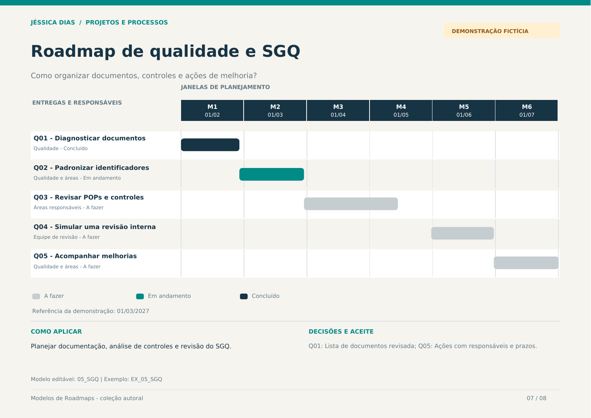

# Roadmap de qualidade e SGQ

**Quando usar:** Planejar documentação, análise de controles e revisão do SGQ.  
**Horizonte:** Seis meses de organização e revisão  
**Pergunta orientadora:** Como organizar documentos, controles e ações de melhoria?



## Modelo editável

Abra a aba **05_SGQ** na [planilha da coleção](../arquivos/Modelos_de_Roadmaps_Jessica_Dias.xlsx). A aba **EX_05_SGQ** contém o exemplo preenchido. Os campos amarelos são editáveis; status e prioridade possuem listas de seleção.

Defina a data-base e a data de revisão. O desenho acompanha as datas informadas em cada entrega.

## Estrutura para copiar

```markdown
| Entrega ou iniciativa | Responsável | Início | Fim | Status | Marco de aceite |
| --- | --- | --- | --- | --- | --- |
| [Preencher] | [Responsável] | [Data ou horizonte] | [Data] | [Status] | [Critério de aceite] |
```

## Exemplo preenchido

Todos os nomes de iniciativas, equipes, datas e status abaixo são fictícios.

| Entrega ou iniciativa | Responsável | Início | Fim | Status | Marco de aceite |
| --- | --- | --- | --- | --- | --- |
| Q01 - Diagnosticar documentos | Qualidade | 01/02/2027 | 28/02/2027 | Concluído | Lista de documentos revisada |
| Q02 - Padronizar identificadores | Qualidade e áreas | 01/03/2027 | 31/03/2027 | Em andamento | Regras de identificação aprovadas |
| Q03 - Revisar POPs e controles | Áreas responsáveis | 01/04/2027 | 15/05/2027 | A fazer | Conteúdo e responsáveis revisados |
| Q04 - Simular uma revisão interna | Equipe de revisão | 01/06/2027 | 30/06/2027 | A fazer | Observações e evidências registradas |
| Q05 - Acompanhar melhorias | Qualidade e áreas | 01/07/2027 | 31/07/2027 | A fazer | Ações com responsáveis e prazos |

## Revisão do planejamento

- Reavalie prioridades, responsáveis e critérios de aceite a cada ciclo.
- Registre mudanças de janela e decisões relevantes.
- Use dependências como referências: elas não reagendam outras entregas automaticamente.
- Atualize o resultado observado quando houver evidência de aplicação.

[Voltar à coleção](../README.md) · [Guia visual em PDF](../arquivos/Guia_Visual_Modelos_de_Roadmaps.pdf)
