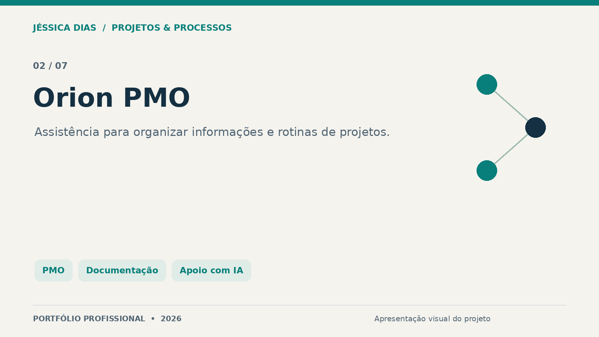
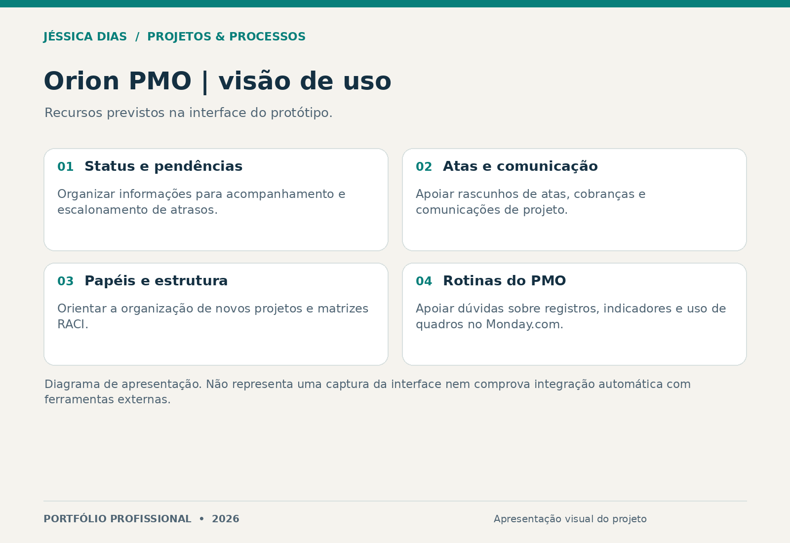

# Orion PMO

Protótipo de assistente voltado a rotinas de um escritório de projetos: organizar informações, estruturar comunicações e apoiar o acompanhamento do trabalho.

**Tipo:** protótipo de ferramenta de apoio ao PMO.  
**Papel da autora:** concepção da proposta, organização dos casos de uso e estruturação da experiência de apoio à gestão.

## Problema e abordagem

Pendências, registros e comunicações de projeto exigem clareza e consistência. A proposta do Orion PMO é oferecer pontos de partida para tarefas recorrentes, mantendo a análise e a decisão com a pessoa responsável pelo projeto.

## Recursos representados na interface

- Apoio à estruturação de status, cobranças de pendências e escalonamento de atrasos.
- Rascunhos de atas e comunicações de projeto.
- Orientações para matriz RACI e organização de novos projetos.
- Apoio a dúvidas sobre registros, indicadores e quadros de acompanhamento no Monday.com.

A imagem é um diagrama criado para esta apresentação, não uma captura da interface original. Nomes, dados e contexto de organizações foram omitidos.

## Entrega e estágio

Protótipo com interface e atalhos de tarefas para assistência a rotinas de projetos. Esta vitrine não comprova integração automática com o Monday.com, execução autônoma de ações, funcionamento de um serviço de IA em produção ou adoção organizacional.

## Competências demonstradas

PMO, organização de projetos, documentação, comunicação com partes interessadas, estruturação de requisitos e desenho de casos de uso para IA.

## Conteúdo desta vitrine

Apresentação e imagens. A implementação, os prompts e os documentos de trabalho não são publicados.

## Autoria e contato

**Jéssica Caroline da Silva Dias** — Projetos, Processos, PMO, Qualidade e Melhoria Contínua.

[LinkedIn](https://www.linkedin.com/in/jessica-carolines-dias/) · [Portfólio central](../../)

[Direitos sobre os materiais](COPYRIGHT.md).
